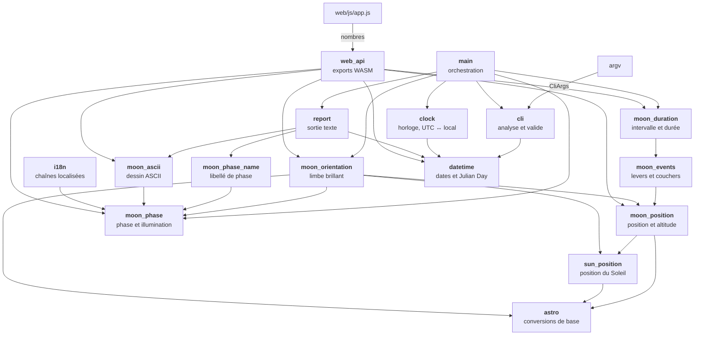

# Structure du projet et principes de conception

## Arborescence

```text
.
├── include/
│   ├── datetime.h             # Représentation date/heure, JD, jour de semaine
│   ├── clock.h                # Heure courante et conversions local/UTC
│   ├── astro.h                # Conversions astronomiques de base
│   ├── sun_position.h         # Position géocentrique du Soleil
│   ├── moon_position.h        # Position lunaire et altitude apparente
│   ├── moon_events.h          # Détection des levers et couchers
│   ├── moon_duration.h        # Calcul de la durée de visibilité
│   ├── moon_phase.h           # Phase et illumination lunaire
│   ├── moon_orientation.h     # Inclinaison du limbe brillant
│   ├── moon_phase_name.h      # Libellés des phases (localisés via i18n)
│   ├── moon_ascii.h           # Rendu ASCII de la phase lunaire
│   ├── cli_status.h           # Codes de retour de l'analyse CLI
│   ├── cli.h                  # Analyse et validation des arguments
│   ├── version.h              # Numéro de version (injecté par le Makefile)
│   ├── i18n.h                 # Internationalisation
│   ├── report.h               # Formatage de la sortie
│   └── web_api.h              # Exports C du noyau WebAssembly
├── src/
│   ├── datetime.c
│   ├── clock.c
│   ├── astro.c
│   ├── sun_position.c
│   ├── moon_position.c
│   ├── moon_events.c
│   ├── moon_duration.c
│   ├── moon_phase.c
│   ├── moon_orientation.c
│   ├── moon_phase_name.c
│   ├── moon_ascii.c
│   ├── cli.c
│   ├── i18n.c
│   ├── report.c
│   ├── web_api.c              # Exports C du noyau WebAssembly
│   └── main.c                 # Orchestration
├── tests/
│   ├── support/
│   │   ├── test_runner.c      # Runner partagé (PASS/FAIL/SKIP)
│   │   └── test_runner.h
│   ├── test_datetime.c
│   ├── test_clock.c
│   ├── test_astro.c
│   ├── test_moon_position.c
│   ├── test_sun_position.c
│   ├── test_moon_events.c
│   ├── test_moon_duration.c
│   ├── test_moon_duration_reference.c
│   ├── test_moon_phase.c
│   ├── test_moon_orientation.c
│   ├── test_moon_ascii.c
│   ├── test_cli.c
│   ├── test_i18n.c
│   ├── test_report.c
│   ├── test_web_api.c
│   ├── test_web_pages.c
│   ├── test_integration.c
│   ├── web/                   # Suites Node du frontal web
│   │   ├── test_web_wasm.mjs
│   │   ├── test_date_time.mjs
│   │   ├── test_values.mjs
│   │   ├── test_format.mjs
│   │   ├── test_cities.mjs
│   │   ├── test_settings.mjs
│   │   ├── test_preview.mjs
│   │   ├── test_chart.mjs
│   │   ├── test_theme.mjs
│   │   └── test_app.mjs
│   └── fuzz/
│       └── fuzz_smoke.c       # Harnais de fuzzing (ASan/UBSan)
├── scripts/
│   ├── coverage_report.awk    # Rapport de couverture lisible
│   └── coverage_check.awk     # Seuils de couverture
├── web/
│   ├── index.html
│   ├── styles.css
│   └── js/                    # Code de la page
│       ├── app.js             # Assemblage de l'interface et des événements
│       ├── date_time.js       # Dates, heures et fuseaux horaires
│       ├── values.js          # Conversions et normalisation de valeurs
│       ├── format.js          # Formatage de la sortie web
│       ├── preview.js         # Validation de la saisie et calcul de l'aperçu
│       ├── render.js          # Rendu DOM de l'aperçu
│       ├── cities.js          # Catalogue des villes
│       ├── city_picker.js     # Autocomplétion de la ville
│       ├── chart.js           # Rendu du graphique
│       ├── theme.js           # Résolution et application du thème
│       ├── moon_core.mjs      # Noyau WebAssembly généré
│       └── moon_core.wasm     # Binaire WebAssembly généré
├── Makefile
├── LICENSE
├── .clang-tidy
├── .clang-format
├── AGENTS.md
└── README.md
```

## Version

Le numéro de version est lu depuis l'étiquette Git la plus proche
(`git describe --tags --match 'v[0-9]*'`), donc depuis les releases GitHub. Le
Makefile l'injecte dans `main.c` via `-DMOON_VERSION`, et le fige dans
`build/version.txt` pour ne recompiler `main.c` qu'après un changement de
version. Hors dépôt Git, `include/version.h` fournit la valeur de repli.

## Vue d'ensemble

Le graphe ci-dessous est celui des en-têtes inclus : une flèche `A → B` signifie
que `A` utilise `B`. Il se lit de haut en bas, des entrées vers la sortie.



Ce que chaque module apporte :

- **`datetime`** : la brique de base — `DateTime`, Julian Day, jour de semaine.
  La conversion inverse (`datetime_from_julian`) choisit le calendrier julien
  avant la réforme grégorienne, et `datetime_to_julian_gregorian` force le
  calendrier grégorien proleptique pour les champs fournis par la bibliothèque C.
- **`clock`** : l'heure courante et les conversions UTC ↔ local. Les
  conversions passent par le calendrier grégorien proleptique pour les champs
  de `struct tm`, ce qui évite un décalage de dix jours avant 1582. La source
  d'horloge est injectable (`clock_set_source`) pour fixer l'instant en test.
- **`astro`** : normalisation des angles, trigonométrie en degrés, obliquité et
  passage écliptique → équatorial, temps sidéral moyen.
- **`sun_position`** : la position du Soleil, source des perturbations lunaires et
  de l'orientation du limbe.
- **`moon_position`** : la position et l'altitude de la Lune pour un instant.
- **`moon_events`** : les levers et couchers d'un intervalle. Le pas de balayage
  se resserre à trente secondes au voisinage de l'horizon pour ne pas manquer
  une traversée brève.
- **`moon_duration`** : l'intervalle lever/coucher qui chevauche la journée, et
  sa durée. Sans aucun croisement, la Lune est déclarée `all_day` (24 h) ou
  `none` (0 h) selon son altitude au début de la journée.
- **`moon_phase`** : la phase et l'illumination.
- **`moon_orientation`** : l'angle du limbe brillant, géocentrique ou par rapport
  à la verticale du lieu.
- **`moon_phase_name`** : le libellé localisé de la phase.
- **`moon_ascii`** : le dessin ASCII du disque lunaire.
- **`report`** : le formatage de la sortie texte.
- **`cli`** : l'analyse et la validation des arguments.
- **`i18n`** : les chaînes de l'interface et de l'usage.
- **`web_api`** : les exports C du noyau WebAssembly.
- **`main`** : l'enchaînement, pour le CLI. `run_cli` prend les flux de sortie
  en paramètre, ce qui permet de l'exercer sans lancer le processus ; `main` se
  limite à `i18n_init` et à l'appel avec `stdout`/`stderr`.

Deux remarques de lecture :

- `astro`, `sun_position`, `moon_position`, `moon_events`, `moon_duration`,
  `moon_phase` et `moon_orientation` ne dépendent que du calcul : ce sont les
  modules purs. `moon_orientation` s'appuie sur `moon_position` et
  `sun_position`, jamais sur la présentation.
- `i18n` ne remonte plus vers `cli` : le type `CliStatus` vit dans
  `include/cli_status.h`, un en-tête sans dépendance que partagent `cli`,
  `i18n` et `main`. La flèche `i18n → cli` a donc disparu, et les modules de
  présentation ne connaissent plus l'analyse des arguments.

La table des responsabilités ci-dessous détaille chaque module.

## Principes de conception

Le projet suit le **principe de responsabilité unique (SRP)** :

Chaque module doit avoir une seule raison de changer. Les responsabilités
distinctes sont séparées dans des fonctions ou des modules dédiés plutôt que de
les regrouper dans une fonction fourre-tout.

| Module | Responsabilité |
| -------- | ---------------- |
| `datetime` | Représentation date/heure, conversion Julian Day, jour de semaine et validation |
| `clock` | Heure courante, conversions local/UTC et conversions Julian Day |
| `astro` | Conventions d'angle, trigonométrie en degrés, obliquité, conversion écliptique → équatorial et temps sidéral moyen |
| `sun_position` | Position géocentrique du Soleil (ascension droite, déclinaison, longitude écliptique) |
| `moon_position` | Position lunaire (ascension droite, déclinaison, distance) et altitude apparente |
| `moon_events` | Recherche des changements de signe de l'altitude à l'horizon |
| `moon_duration` | Sélection de l'intervalle lever/coucher et calcul de la durée |
| `moon_phase` | Calcul de la phase et de l'illumination lunaire |
| `moon_orientation` | Angle de position du limbe brillant et inclinaison par rapport à la verticale |
| `moon_phase_name` | Libellés des phases (localisés via i18n) |
| `moon_ascii` | Rendu ASCII de la phase lunaire et orientation du terminateur |
| `cli` | Analyse, validation et formatage de l'usage des arguments |
| `cli_status` | Codes de retour de l'analyse (`CliStatus`), partagés sans dépendance |
| `i18n` | Chaînes localisées de l'interface et de l'usage |
| `report` | Formatage de la sortie |
| `web_api` | Exports C du noyau WebAssembly |
| `main` | Orchestration des modules (`run_cli` testable, flux paramétrés) |
| `web/js/date_time.js` | Parsing de dates et d'heures, fuseaux horaires et clés de date |
| `web/js/values.js` | Conversion en nombre fini et normalisation de texte |
| `web/js/format.js` | Formatage de la durée, des événements, de l'illumination et des angles |
| `web/js/cities.js` | Catalogue des villes et recherche par nom |
| `web/js/settings.js` | Lecture et écriture des réglages mémorisés |
| `web/js/preview.js` | Validation de la saisie et calcul de l'aperçu |
| `web/js/render.js` | Rendu DOM de l'aperçu et messages d'erreur |
| `web/js/city_picker.js` | Autocomplétion de la ville |
| `web/js/chart.js` | Rendu du graphique web |
| `web/js/theme.js` | Thème clair/sombre web |
| `web/js/app.js` | Assemblage de l'interface et des événements |

### Séparation astronomie / présentation

Les calculs de position, d'événements et de durée sont indépendants du
formatage. Le module `report` ne fait que présenter un `MoonDurationReport`
déjà calculé par `main`.

Le dessin ASCII suit la même règle : `moon_ascii` reçoit l'angle du limbe dans
`MoonAsciiState` et se contente de l'appliquer. Il ne recalcule ni la position du
Soleil, ni l'angle : seule la géométrie du terminateur (une droite dont la
normale suit le limbe) relève du rendu. Le dessin est orienté comme le voit
l'observateur, verticale en haut et est à gauche.

### Contrat des valeurs indéterminées

Trois valeurs conventionnelles traversent les frontières de module, et sont
explicitement nommées pour éviter qu'une valeur aberrante ne soit interprétée
comme un résultat :

| Frontière | Valeur | Signification |
| ----------- | -------- | --------------- |
| `moon_phase_from_julian_day` | `MOON_PHASE_INVALID` (`-1`) | Julian Day non fini (NaN, ±infini) |
| `moon_bright_limb_angle*` | `NAN` | Limbe non identifiable ou entrée invalide |
| `MoonAsciiState.has_bright_limb_angle` | `0` | Orientation inconnue : déduite de la phase |
| `moon_web_*` (exports WASM) | `MOON_WEB_UNDEFINED` (NaN `double`) | Entrée invalide ou événement inexistant |
| `web/js/app.js` | `NaN`, `—` | Absence d'événement, de phase ou d'illumination |

`i18n_moon_phase_name` affiche le libellé « inconnu » pour
`MOON_PHASE_INVALID`, de sorte qu'un Julian Day aberrant ne peut plus être
silencieusement classé comme un croissant de lune. Côté web, `moon_web_phase` et
`moon_web_illumination` valident le Julian Day avant de déléguer au noyau ; leurs
variantes datées (`moon_web_phase_at`, `moon_web_illumination_at`,
`moon_web_bright_limb_angle_at`) valident de plus la date, l'heure et l'offset
avant de déléguer, et l'interface affiche `—` plutôt qu'une valeur numérique.

Les réglages relus depuis le `localStorage` passent par `toFiniteNumber`
(`web/js/values.js`) : `Number(null)` et `Number("")` valent `0`, ce qui ferait
accepter une position corrompue comme valide. La fonction ne rend un nombre que
pour une entrée numérique ou une chaîne non vide, et `null` sinon.

L'illumination est présentée en pourcentage avec **une décimale**, au CLI
(`%.1f%%`) comme sur le web (`formatIllumination`, `web/js/format.js`) : la
valeur varie de plusieurs points par jour, la décimale distingue donc des
instants que l'entier écraserait. Les bornes sont bornées à 0–100 % et une
valeur non finie donne `—`.

`moon_bright_limb_angle` suit la même convention : un `NAN` signifie que le
limbe n'est pas identifiable. `main` le traduit en `report.has_inclination = 0`
et le rapport affiche le libellé « Indisponible » plutôt qu'un angle. Les
formules, l'angle de convention et les seuils de disponibilité sont décrits dans
[Inclinaison du limbe](ALGORITHME.md#7-inclinaison-du-limbe) ; ils ne sont pas
répétés ici.

### Calculateur web

Le calcul astronomique reste dans le noyau C compilé en WebAssembly.
`web/js/app.js` assemble l'interface et câble les événements ; `web/js/preview.js`
valide la saisie et appelle le noyau ; `web/js/render.js` met à jour le DOM ;
`web/js/chart.js` trace la ligne d'horizon en rouge pointillé, localise le maximum
de la courbe et affiche la verticale avec la lettre `M`.

Les réglages du formulaire sont écrits dans le `localStorage` après une accalmie
de 200 ms (`persistSettings`) puis vidés sur `pagehide` : une frappe ne
déclenche pas une écriture disque par touche. Le module `moon_core.mjs` et le
binaire `moon_core.wasm` sont chargés avec une version de cache (`?v=`) pour
qu'un navigateur ne continue pas d'exécuter une ancienne version après une
modification de `app.js`. La version de cache du binaire WebAssembly est la
constante `BUILD_VERSION` de `app.js` : elle et les numéros `?v=` des imports,
ainsi que l'entrée `app.js` de `index.html`, sont incrémentés ensemble après
toute modification servie. Sous Node, les tests conservent la résolution de
fichier par défaut du module.

**Choix retenu : la page est en français.** Les libellés, les messages d'erreur
et les noms de phases sont écrits en dur dans les modules web ; le CLI, lui, est
localisé en cinq langues (voir [I18N](I18N.md)). Une page multilingue demanderait
de porter les tables de chaînes côté JavaScript, ce qui n'apporte rien à la
démonstration.

La fenêtre locale d'une journée peut chevaucher deux fuseaux lorsque la journée
contient un changement d'heure. `web/js/date_time.js` résout donc les deux offsets
UTC des bornes de la journée (`localDayOffsets`), et `moon_web_window` reçoit
l'offset de début et l'offset de fin pour balayer l'intervalle réel de 23 h ou
25 h. Les autres exports (`moon_web_phase`, `moon_web_illumination`) continuent
d'utiliser l'offset de midi. Côté web, l'aperçu ne réutilise pas cet offset de
midi pour la phase, l'illumination et l'inclinaison : `instantOffsetMinutes`
(`web/js/date_time.js`) résout le décalage à l'instant demandé, ce qui évite un
décalage d'une heure lorsque la date contient un changement d'heure.

Les repères de l'axe du graphique sont calculés par `hourTickLabels`
(`web/js/format.js`).

`moon_web_window` retourne `NAN` lorsque la Lune ne se lève pas ou ne se couche
pas. `moon_web_duration_mode` lève cette ambiguïté : il renvoie `0` pour une
journée à deux événements, `1` pour une Lune visible toute la journée (24 h) et
`2` pour une Lune absente toute la journée (0 h). Il reçoit lui aussi l'offset de
début et l'offset de fin, afin de balayer la fenêtre réelle de 23 h ou 25 h.
L'aperçu web expose ce mode et n'appelle `moon_web_duration_mode` que lorsque la
fenêtre est indéterminée, ce qui évite un second calcul sur les journées
ordinaires.

**Choix retenu : l'abscisse est le temps écoulé depuis minuit local**, de 0 à la
durée réelle de la journée (`dayHours`, soit 23, 24 ou 25 heures), et non l'heure
d'horloge. La courbe échantillonne donc
`moon_web_altitude(dayStartJulianDay + hour / 24)` à pas régulier : l'axe reste
linéaire et le balayage d'altitude est uniforme. Les étiquettes, elles, sont
converties en heure locale réelle via `Intl.DateTimeFormat`, de sorte qu'un jour
de 23 h ou 25 h affiche des heures non équidistantes. Le dernier repère d'une
journée de 25 h tombe donc à 01:00 le lendemain et porte le suffixe `+1 j`. La
verticale « Maintenant » et le maximum `M` sont positionnés sur la même
abscisse, en heures écoulées.

Le formulaire de calcul est un
élément `<form>` dont la soumission est interceptée pour éviter tout
rechargement de page.

Le fuseau horaire peut être choisi explicitement ou laissé en mode
`Automatique` : `resolveTimezone` (`web/js/date_time.js`) résout alors le fuseau du
navigateur (`Intl.DateTimeFormat().resolvedOptions().timeZone`). La page est
servie avec une politique de sécurité de contenu (`Content-Security-Policy`) qui
interdit tout appel réseau sortant, n'autorise le chargement du binaire
WebAssembly que depuis la même origine (`connect-src 'self'`) et n'en autorise la
compilation que via `wasm-unsafe-eval`. Une directive `connect-src 'none'`
empêcherait le `fetch` du module : c'est le rôle de `test_web_pages` de verrouiller
ce point.

### Effet de bord de l'analyse des arguments

`cli_parse` ne modifie aucun état global : la langue demandée est exposée dans
`CliArgs.lang`, et c'est `main` qui l'applique via `i18n_set_lang` avant
d'afficher le moindre message, y compris lorsque l'analyse échoue. L'état
`current_lang` de `i18n` reste donc un état de présentation, modifié
uniquement par l'appelant.

La surface d'exports WebAssembly est déclarée explicitement dans le `Makefile`
(`WASM_EXPORTS`, `WASM_RUNTIME_METHODS`) : Emscripten n'exporte pas les symboles
internes de la bibliothèque standard, si bien que `_malloc` et `_free` doivent y
figurer pour que `web/js/app.js` et les tests allouent les pointeurs de sortie de
`moon_web_window`. Tout nouvel export doit être ajouté à `WASM_EXPORTS`.

### Thème clair/sombre

Le module `web/js/theme.js` résout la préférence `system`, `light` ou `dark` et
applique le thème au document. Le choix est mémorisé avec les autres réglages
et le thème système suit la préférence de l'appareil.

### Rendu ASCII de la lune

Le module `moon_ascii` est responsable du rendu ASCII de la phase lunaire. Les
calculs de disque, de zone éclairée et de symboles restent séparés de la logique
de calcul astronomique et du formatage du rapport.

### Sortie CLI

Le rapport affiche les informations textuelles puis un dessin ASCII de la phase
lunaire. Le dessin est déterministe, borné par `MOON_ASCII_WIDTH` et
`MOON_ASCII_HEIGHT`, et chaque ligne est terminée par un caractère nul.

### Internationalisation (i18n)

Le module `i18n` regroupe les chaînes localisées dans des tableaux statiques,
sans dépendance au formatage. Les langues prises en charge, l'ordre de sélection
et la procédure d'ajout d'une chaîne sont décrits dans [I18N](I18N.md).

`i18n_usage_strings()` renvoie une structure `I18nUsageStrings` **par valeur** :
la fonction ne conserve aucun tampon statique, si bien que deux appels
imbriqués ne se marchent pas dessus. Elle ne dépend que de `cli_status.h`, de
sorte que la présentation ignore tout de l'analyse des arguments.

### Documentation

Toute modification de fonctionnalité, d'option CLI, de variable d'environnement
ou de cible Makefile doit s'accompagner d'une mise à jour du document
propriétaire — celui que la table du `README.md` désigne pour la question — et,
le cas échéant, de `AGENTS.md`. La documentation doit toujours refléter l'état
actuel du code.
